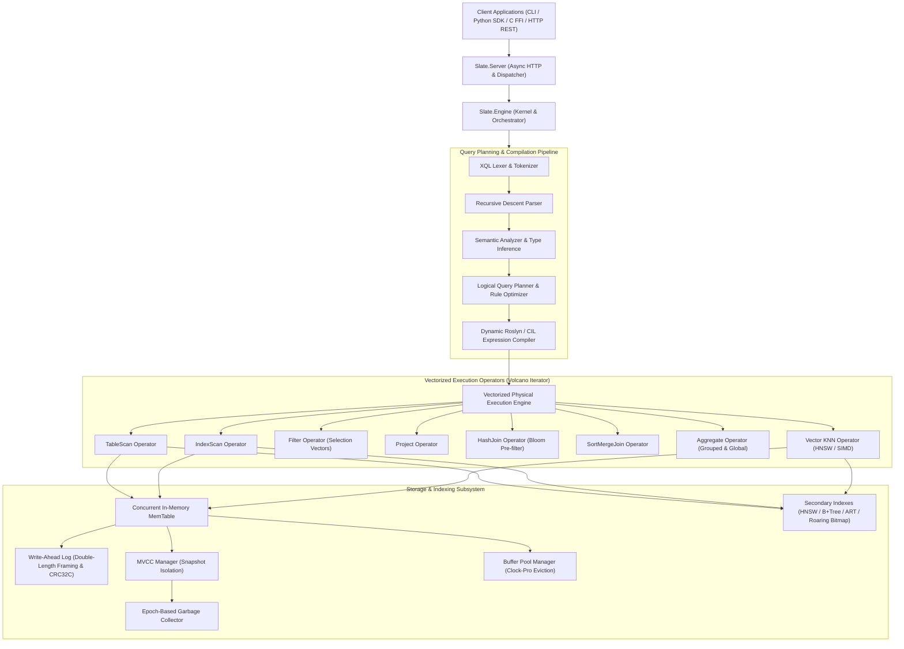

# Slate Architecture Specification

## 1. System Overview

Slate is a unified Hybrid Transactional/Analytical Processing (HTAP) database engine featuring native multi-dimensional vector search, lock-free Multi-Version Concurrency Control (MVCC), and SIMD-accelerated columnar execution. Slate harmonizes OLTP write throughput with OLAP vectorized analytics and sub-millisecond approximate nearest neighbor (ANN) retrieval in a single memory-efficient engine.

---

## 2. Component Hierarchy

### 2.1 Storage & Memory Hierarchy
1. **MemTable**: A concurrent sorted skiplist/hash table storing active transactional mutations. Row versions are stamped with transaction IDs and read snapshot timestamps.
2. **BufferPoolManager**: Clock-Pro page replacement cache governing 4 KB and 64 KB memory-mapped block frames.
3. **Write-Ahead Log (WAL)**: Double-length framed sequential log records guarded with Castagnoli CRC32C hardware checksums. Guarantees durability before transaction commit acknowledgments.
4. **Secondary Index Suite**:
   - **HNSW Graph**: Hierarchical Navigable Small World proximity graph for logarithmic vector search.
   - **Adaptive Radix Tree (ART)**: Cache-conscious prefix tree with adaptive node sizes (Node4, Node16, Node48, Node256).
   - **B+Tree**: Clustered balanced tree for point lookups and leaf range scans.
   - **Roaring Bitmap**: 64-bit compressed bitmap index for low-cardinality categorical filters.

### 2.2 Transactional Concurrency (MVCC & Epoch GC)
Slate implements Snapshot Isolation (SI) and Serializable Snapshot Isolation (SSI). Every transaction observes a consistent snapshot timestamp $T_{read}$ established at inception. Write-write conflicts are detected via first-committer-wins validation. Obsolete row versions and tombstoned records are retired into safe epochs and physically purged once the global minimum read timestamp advances past their expiration.

### 2.3 Vectorized Query Execution (Morsel-Driven Volcano)
Query execution operates on columnar `VectorBatch` data slices (512 to 4096 rows). Column values are contiguous in memory, eliminating per-row boxing overhead. Filtering operations populate integer `SelectionVector`s rather than reallocating or copying data arrays, allowing zero-copy predicate composition down the operator tree.

### 2.4 Hybrid SIMD Vector Search
Vector similarity queries utilize AVX2 / ARM NEON 256-bit SIMD hardware intrinsics. The engine computes 8 single-precision floating-point fused multiply-accumulates per CPU clock cycle. For large datasets, the query planner routes queries through the HNSW index graph; for small filtered subsets, it seamlessly falls back to exact SIMD brute-force linear scans.
