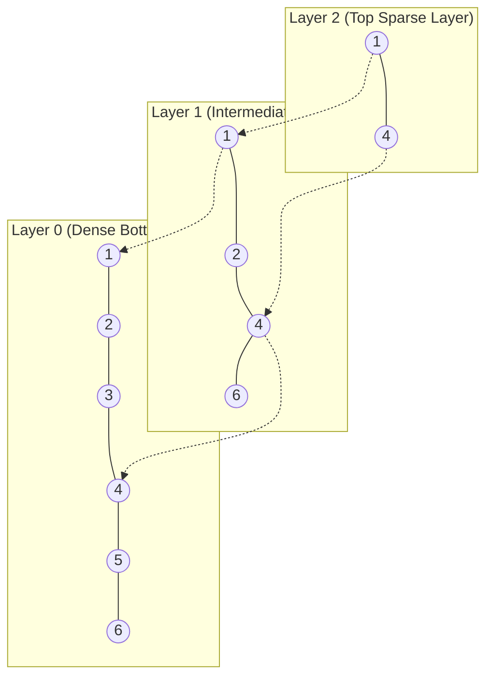

# Slate Indexing Internals

## 1. Hierarchical Navigable Small World (HNSW)

The HNSW index provides approximate nearest neighbor (ANN) vector search with $O(\log N)$ query complexity.

### Algorithmic Parameters
- $M$: Maximum number of bi-directional connection links per node on layers $> 0$ (default: `16`).
- $M_0$: Maximum number of connections on layer 0 (set to $2 \times M = 32$).
- $efConstruction$: Search queue size during node insertion (default: `64` or `128`).
- $efSearch$: Dynamic priority queue size during query execution (default: `Math.Max(k, 32)`).
- $m_L = 1 / \ln(M)$: Level generation scale factor. Node layer assignment follows exponential distribution $l = \lfloor -\ln(uniform(0, 1)) \cdot m_L \rfloor$.

### Search Algorithm
1. Start at top layer entry point with greedy routing.
2. In each layer, evaluate distances to neighbors and traverse to the closest neighbor until reaching a local minimum.
3. Drop down to the next lower layer and repeat greedy routing using the entry point found above.
4. On Layer 0, perform best-first search with priority queue $W$ of size $efSearch$.
5. Return top $k$ nearest elements sorted by distance.

---

## 2. Adaptive Radix Tree (ART)

The Adaptive Radix Tree replaces conventional B-trees for ordered string and integer prefix search, achieving memory efficiency while avoiding costly node rebalancing.

### Adaptive Node Types
1. **Node4**: Holds up to 4 child pointers and 4 sorted key bytes. Key search utilizes linear scanning.
2. **Node16**: Holds up to 16 child pointers and 16 key bytes. Key search is accelerated via 128-bit SIMD comparison (`Vector128`).
3. **Node48**: Uses a 256-entry byte lookup table mapping key byte values to an array of 48 child pointers. Provides $O(1)$ child indexing without full 256-pointer allocation.
4. **Node256**: Direct 256-entry pointer array indexed directly by key byte ($O(1)$ child resolution).

### Prefix Compression
Path compression collapses long single-child chains into a compressed prefix array stored in the parent node. During traversal, prefix bytes are verified before accessing child nodes.

---

## 3. Clustered B+Tree

Slate utilizes a cache-line aware B+Tree for primary key index lookup and range scans:
- Leaf nodes form a doubly linked list (`Next`, `Prev`), allowing linear range scans across leaf pages without revisiting internal tree nodes.
- High fanout ($B = 16$ to $64$) yields shallow tree depth (depth $\le 3$ for millions of keys).
- Node splitting maintains minimum occupancy ($\lceil B / 2 \rceil$ keys).

---

## 4. 64-Bit Roaring Bitmap Index

For low-cardinality categorical filters (e.g. status codes, country codes, boolean flags), Slate applies Roaring Bitmaps:
- Partitions 64-bit integer IDs by high 48-bit chunks.
- Within each 16-bit container:
  - **Array Container**: Used when cardinality $< 4096$ values. Stores sorted 16-bit integers.
  - **Bitset Container**: Used when cardinality $\ge 4096$ values. Uses a 1024-word 65536-bit bitset.
  - **Run Container**: Used for dense runs of contiguous integers.
- Supports bitwise SIMD AND, OR, and XOR operations directly on bitset chunks.
