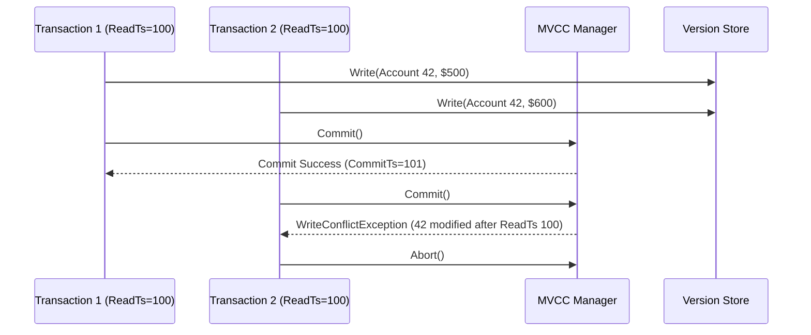

# Multi-Version Concurrency Control (MVCC) and Crash Recovery

## 1. Multi-Version Concurrency Control (MVCC)

Slate guarantees ACID transactional properties using Multi-Version Concurrency Control under Snapshot Isolation (SI) and Serializable Snapshot Isolation (SSI).



### Snapshot Isolation Rules
1. **Read Visibility**: A transaction with read timestamp $T_{read}$ can observe a record version $V$ if and only if:
   - $V$ was created by the reading transaction itself, or
   - $V.CreatedTimestamp \ne 0$ and $V.CreatedTimestamp \le T_{read}$, and
   - $V.ExpiredTimestamp = 0$ or $V.ExpiredTimestamp > T_{read}$.
2. **First-Committer-Wins (Write-Write Conflict Detection)**:
   - When transaction $T$ requests commit, the manager inspects every key in $T.WriteSet$.
   - If any key was committed with a timestamp $T_{commit} > T_{read}$, a write-write conflict is triggered.
   - Transaction $T$ is aborted, and all speculative mutations are purged.

---

## 2. Epoch-Based Garbage Collection

In high-throughput environments, obsolete versions cannot be reclaimed immediately because concurrent reader transactions may still hold snapshots preceding the update.

### Algorithm
1. Compute the safe global low watermark:
   $$W_{safe} = \min_{t \in Active} t.ReadTimestamp$$
2. When a record version is superseded or deleted, it is retired with expiration timestamp $T_{exp}$.
3. During collection cycles, the garbage collector scans retired lists and reclaims physical memory for all entries where:
   $$T_{exp} \le W_{safe}$$
4. Reclaimed memory frames are returned to the buffer pool.

---

## 3. ARIES Crash Recovery

Slate implements the ARIES (Algorithms for Recovery and Isolation Exploiting Semantics) recovery protocol across three sequential phases:

```mermaid
flowchart LR
    Crash[Crash Point] --> P1[Phase 1: Analysis]
    P1 --> P2[Phase 2: Redo (Repeat History)]
    P2 --> P3[Phase 3: Undo (Roll Back Losers)]
    P3 --> Ready[Database Ready]
```

### Phase 1: Analysis
- Scans forward through the Write-Ahead Log from the last recorded checkpoint.
- Identifies active transactions at crash time and categorizes them:
  - **Winners**: Transactions that logged a `Commit` record before the crash.
  - **Losers**: Transactions that logged a `Begin` record without a subsequent `Commit` record.

### Phase 2: Redo (Repeating History)
- Scans forward from the minimum RedoLSN to the end of the log.
- Replays all logged insert, update, and delete mutations for both winner and loser transactions.
- Restores the exact state of memory tables and data pages at the instant of the crash.

### Phase 3: Undo
- Scans backward through the log.
- Reverses and removes all changes introduced by loser transactions.
- Leaves committed state consistent and free of partial uncommitted mutations.
